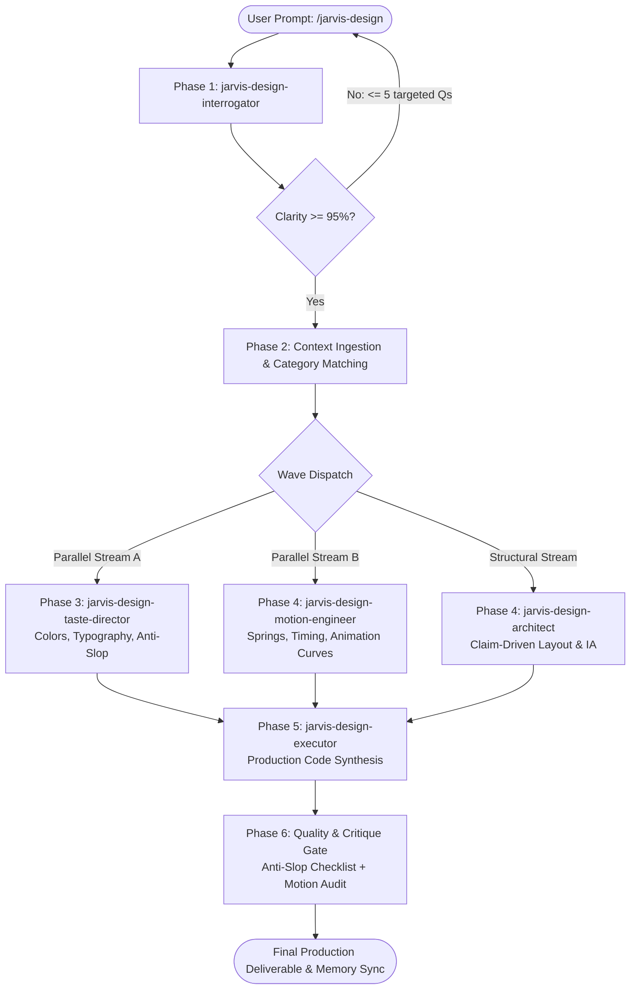
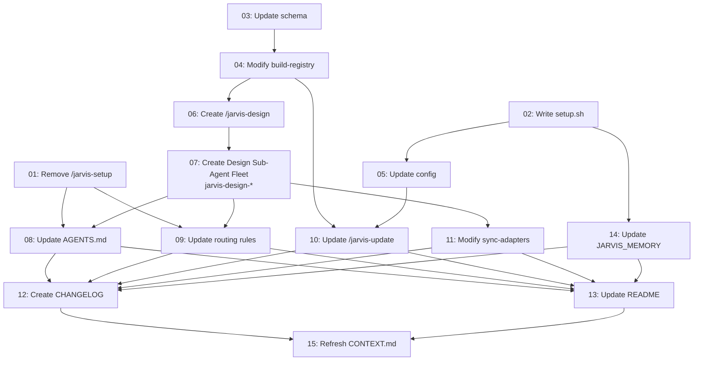

# Jarvis-Matrix v0.2.0 — Product Requirement Prompt

> Links: [[JARVIS_MEMORY.md]] | [[CONTEXT.md]] | [[PROJECT_MEMORY.md]]
>
> **CRITICAL CONSTRAINT:** This document is spec-only. No application code or repository integration is performed until explicit user confirmation.

---

## 1. Executive Summary

v0.1.0 established Jarvis-Matrix as a develop-only orchestrator routing six engineering plugins through 11 slash commands. v0.2.0 introduces a **second pillar — design** — adding first-class UI/UX, aesthetic taste curation, and animation capabilities via four external design plugin repositories and a new `/jarvis-design` skill.

Furthermore, v0.2.0 mirrors the elite sub-agent architecture from `.gemini/config/plugins/apex-design` into the `Jarvis-Matrix` ecosystem under the `jarvis-` namespace with a **strict "design" keyword naming requirement**, establishing zero-bloat context isolation, parallel/sequential execution handoffs, and Obsidian memory bindings.

### Key Deltas from v0.1.0

| Change | Type | Impact |
|--------|------|--------|
| Two-pillar `develop/` + `design/` plugin directory | **NEW** | Directory structure, registry schema, all scanning scripts |
| `/jarvis-setup` slash skill | **REMOVED** | Replaced by automated `scripts/setup.sh` bootstrap script |
| `scripts/setup.sh` (bootstrap script) | **NEW** | Clones all 10 repos, runs build-registry, sync-adapters, initializes memory |
| `/jarvis-design` slash skill | **NEW** | Master design router supporting autonomous (1-call) and direct invocation modes |
| Mirrored Design Sub-Agent Fleet | **NEW** | 5 specialized design sub-agents (`jarvis-design-interrogator`, `jarvis-design-architect`, `jarvis-design-taste-director`, `jarvis-design-motion-engineer`, `jarvis-design-executor`) + `jarvis-designer` |
| Mandatory "design" Keyword Rule | **NEW** | Every skill & sub-agent cloned from `apex-design` MUST include "design" to eliminate any confusion with `develop` skills |
| Exclusion of `apex-update` | **NEW** | `apex-update` is explicitly NOT cloned; repository updates are unified under `/jarvis-update` |
| Zero-Bloat Context Isolation | **NEW** | Sub-agents never load full repo trees; strictly scoped to relevant skill markdown slices |
| Parallel vs. Sequential Design Pipeline | **NEW** | Interrogation gate → parallel token/curve synthesis → layout → execution → sequential critique |
| Mandatory 4-Repo Ensemble Rule | **NEW** | `/jarvis-design` NEVER skips any of the 4 design repos during UI/UX work |
| Dual-Mode Accessibility Rule | **NEW** | Both 1-call autonomous synthesis and direct invocation of individual skills & sub-agents |
| No-Rewrite Rule | **NEW** | Design repos are dynamically referenced from clone locations; never duplicated |
| Obsidian Memory Binding | **NEW** | Bi-directional sync with `[[JARVIS_MEMORY.md]]` and `[[PROJECT_MEMORY.md]]` |
| `/jarvis-update` slash skill | **MODIFIED** | Expanded to iterate both `develop/` (6 repos) and `design/` (4 repos) |
| `build-registry.sh` | **MODIFIED** | Scans both `develop/` and `design/` directories, produces v2 registry schema |
| `sync-adapters.sh` | **MODIFIED** | Generates adapters for `/jarvis-design`, design sub-agents, and all individual design skills |
| `config/registry.json` | **MODIFIED** | New `design_plugins` section alongside existing `plugins` |
| `rules/AGENTS.md` | **MODIFIED** | Remove `/jarvis-setup`, add `/jarvis-design` routing, design sub-agent fleet, context isolation |
| `rules/jarvis-routing.md` | **MODIFIED** | Add design plugin routing reference, design sub-agent tree, memory matrix |
| `CHANGELOG.md` | **NEW** | Keep-a-Changelog format, v0.1.0 + v0.2.0 entries |
| `README.md` | **MODIFIED** | Reflect all v0.2.0 changes, dual pillars, setup script, design fleet |

---

## 2. System Architecture — v0.2.0

### 2.1 Updated Directory Blueprint

```
jarvis-matrix/
├── plugin.json                          # version: "0.2.0"
├── README.md                            # MODIFIED — v0.2.0 docs
├── CHANGELOG.md                         # NEW — v0.1.0 + v0.2.0 entries
├── LICENSE
├── JARVIS_MEMORY.md                     # MODIFIED — design plugin versions & aesthetic rules added
│
├── config/
│   ├── jarvis.config.json               # MODIFIED — adds design_plugins_root
│   ├── registry.json                    # MODIFIED — adds design_plugins section (schema v2)
│   └── registry.schema.json             # MODIFIED — schema for design plugins
│
├── scripts/
│   ├── setup.sh                         # NEW — replaces /jarvis-setup skill
│   ├── build-registry.sh                # MODIFIED — scans develop/ + design/
│   ├── sync-adapters.sh                 # MODIFIED — generates design adapters & sub-agent bindings
│   └── cache-manager.sh                 # unchanged
│
├── skills/
│   ├── jarvis-design/                   # NEW — master design router & orchestrator
│   │   └── SKILL.md
│   ├── jarvis-understand/SKILL.md       # unchanged
│   ├── jarvis-context/SKILL.md          # unchanged
│   ├── jarvis-refresh/SKILL.md          # unchanged
│   ├── jarvis-update/                   # MODIFIED — iterates both pillars
│   │   └── SKILL.md
│   ├── jarvis-spec/SKILL.md             # unchanged
│   ├── jarvis-plan/SKILL.md             # unchanged
│   ├── jarvis-build/SKILL.md            # unchanged
│   ├── jarvis-review/SKILL.md           # unchanged
│   ├── jarvis-memory/SKILL.md           # unchanged
│   └── jarvis-project-memory/SKILL.md   # unchanged
│   ❌ jarvis-setup/                     # REMOVED — replaced by scripts/setup.sh
│   ❌ apex-update                       # EXCLUDED — not needed; unified in /jarvis-update
│
├── agents/
│   ├── jarvis-designer.md               # NEW — master design pipeline orchestrator
│   ├── jarvis-design-interrogator.md    # NEW — 1:1 clone from apex-interrogator (≥95% clarity gate)
│   ├── jarvis-design-architect.md       # NEW — 1:1 clone from apex-architect (IA, layout, claim-driven)
│   ├── jarvis-design-taste-director.md  # NEW — 1:1 clone from apex-taste-director (anti-slop, palettes, styles)
│   ├── jarvis-design-motion-engineer.md # NEW — 1:1 clone from apex-motion-engineer (Emil springs, timing budgets)
│   ├── jarvis-design-executor.md        # NEW — 1:1 clone from apex-executor (Impeccable production code)
│   ├── jarvis-analyzer.md               # unchanged (develop pillar)
│   ├── jarvis-builder.md                # unchanged (develop pillar)
│   ├── jarvis-compressor.md             # unchanged (develop pillar)
│   ├── jarvis-planner.md                # unchanged (develop pillar)
│   └── jarvis-reviewer.md               # unchanged (develop pillar)
│
├── rules/
│   ├── AGENTS.md                        # MODIFIED — /jarvis-design routing, design sub-agent fleet, context isolation
│   └── jarvis-routing.md                # MODIFIED — design plugin reference, sub-agent tree, memory matrix
│
├── adapters/
│   ├── cursor/
│   │   ├── jarvis-design.mdc                    # NEW
│   │   ├── jarvis-design-interrogator.mdc       # NEW
│   │   ├── jarvis-design-architect.mdc          # NEW
│   │   ├── jarvis-design-taste-director.mdc     # NEW
│   │   ├── jarvis-design-motion-engineer.mdc    # NEW
│   │   ├── jarvis-design-executor.mdc           # NEW
│   │   └── ... (existing develop + design sub-skills)
│   ├── claude-code/
│   │   ├── jarvis-design.md                     # NEW
│   │   └── ... (existing develop + design sub-skills)
│   └── codex/
│   │   ├── jarvis-design.toml                   # NEW
│   │   └── ... (existing develop + design sub-skills)
│
├── templates/                           # unchanged
│   ├── CONTEXT.template.md
│   ├── JARVIS_MEMORY.template.md
│   └── PROJECT_MEMORY.template.md
│
├── cache/                               # unchanged
│   └── .gitkeep
│
└── .jarvis/
    ├── CONTEXT.md                       # refreshed post-implementation
    └── plans/                           # PRP document and decomposed numbered task files
        ├── PRP-v0.2.0.md                # this document
        ├── 00-plan-overview.md
        ├── 01-remove-jarvis-setup.md
        ├── 02-write-setup-script.md
        ├── 03-update-registry-schema.md
        ├── 04-modify-build-registry.md
        ├── 05-update-jarvis-config.md
        ├── 06-create-jarvis-design-skill.md
        ├── 07-create-jarvis-design-subagents.md
        ├── 08-update-agents-rules.md
        ├── 09-update-routing-rules.md
        ├── 10-update-jarvis-update-skill.md
        ├── 11-modify-sync-adapters.md
        ├── 12-create-changelog.md
        ├── 13-update-readme.md
        ├── 14-update-jarvis-memory.md
        └── 15-refresh-context.md
```

### 2.2 External Plugin Library (Two Pillars)

```
~/.gemini/config/github-plugins/
├── develop/                             # v0.1.0 — Engineering & Orchestration
│   ├── Understand-Anything/             # https://github.com/Egonex-AI/Understand-Anything
│   ├── graphify/                        # https://github.com/Graphify-Labs/graphify (*)
│   ├── humanizer/                       # https://github.com/blader/humanizer
│   ├── ponytail/                        # https://github.com/DietrichGebert/ponytail
│   ├── caveman/                         # https://github.com/JuliusBrussee/caveman
│   └── agent-skills/                    # https://github.com/addyosmani/agent-skills
│
└── design/                              # NEW in v0.2.0 — UI/UX, Taste & Animation
    ├── impeccable/                      # https://github.com/pbakaus/impeccable
    ├── skills/                          # https://github.com/emilkowalski/skills (*)
    ├── taste-skill/                     # https://github.com/leonxlnx/taste-skill
    └── ui-ux-pro-max-skill/             # https://github.com/nextlevelbuilder/ui-ux-pro-max-skill
```

---

## 3. Design Plugin Inventory & Capabilities

### 3.1 `impeccable` (pbakaus/impeccable)
- **Repo URL:** `https://github.com/pbakaus/impeccable`
- **Canonical Skill Path:** `impeccable/.gemini/skills/impeccable/SKILL.md`
- **Domain:** Component polish, high-craft UI details, execution excellence, interaction completeness.
- **Core Standard:** "Finish the job" — no hedging, build with motion off first, verify shipping sizes, pre-delivery checklist (contrast 4.5:1, focus states, responsive, cursor-pointer).

### 3.2 `skills` (emilkowalski/skills)
- **Repo URL:** `https://github.com/emilkowalski/skills/tree/main`
- **Canonical Skills Directory:** `skills/skills/` (15 individual SKILL.md files)
- **Domain:** Mandatory for all animations, transitions, spring physics, and micro-interactions.
- **Key Skills:** `animate`, `animate-expo`, `animation-performance`, `animation-vocabulary`, `apple-design`, `ask-sonner`, `break-ui`, `emil-design-eng`, `find-animation-opportunities`, `improve-animations`, `mobile-native`, `pick-ui-library`, `prototype`, `review-animations`, `write-swift`.
- **Core Standard:** Physics springs, custom cubic-bezier curves (`--ease-out: cubic-bezier(0.23, 1, 0.32, 1)`), frequency gates (100+/day = no animation), duration budgets (100-500ms max), `prefers-reduced-motion`.

### 3.3 `taste-skill` (leonxlnx/taste-skill)
- **Repo URL:** `https://github.com/leonxlnx/taste-skill`
- **Canonical Skill Path:** `taste-skill/skills/taste-skill/SKILL.md`
- **Domain:** Mandatory for visual hierarchy, typography, spacing, and anti-generic aesthetic guardrails.
- **Core Standard:** 247 curated gallery site analysis, subject inventory technique, anti-slop checklist (10 banned patterns), typography pairing, semantic color roles.

### 3.4 `ui-ux-pro-max-skill` (nextlevelbuilder/ui-ux-pro-max-skill)
- **Repo URL:** `https://github.com/nextlevelbuilder/ui-ux-pro-max-skill`
- **Canonical Skills Directory:** `ui-ux-pro-max-skill/.claude/skills/` (7 SKILL.md files: `ui-ux-pro-max`, `design`, `banner-design`, `ui-styling`, `brand`, `slides`, `design-system`)
- **Domain:** Mandatory for design systems, dark/light mode token architecture, accessibility, and UX flows.
- **Core Standard:** 192 industry product categories, 79 searchable UI styles, 34 landing page structure patterns, responsive layout grids.

---

## 4. `/jarvis-design` — Sub-Agent & Skill Routing Architecture

### 4.1 Sub-Agent Rules (`.gemini/config/plugins/apex-design` -> `jarvis-...`)

#### 1. 1-to-1 Blueprint Cloning & Strict "design" Keyword Naming Rule
The sub-agent fleet, prompts, scoring models, and pipelines from `.gemini/config/plugins/apex-design` are mirrored into `Jarvis-Matrix` under a **mandatory naming requirement**:

> **STRICT NAMING RULE:** Every sub-agent and skill mirrored from `apex-design` **MUST contain the keyword "design"** (e.g., `jarvis-design-interrogator`, `jarvis-design-architect`, `jarvis-designer`). If the word "design" is missing from the name, it will be misunderstood and confused with the develop engineering skills (`jarvis-planner`, `jarvis-spec`, `jarvis-builder`).

Mirrored mapping:
1. `apex-interrogator` ➔ **`jarvis-design-interrogator`**: Clarification sub-agent scoring prompts across 6 dimensions to enforce ≥ 95% confidence before design or code generation.
2. `apex-architect` ➔ **`jarvis-design-architect`**: Information architecture sub-agent planning claim-driven section hierarchies, responsive layouts, and conversion funnels.
3. `apex-taste-director` ➔ **`jarvis-design-taste-director`**: Aesthetic curation sub-agent setting color palettes (ground, ink, accent, surface, border, ring), font pairings, spacing, and 10-point anti-slop guardrails.
4. `apex-motion-engineer` ➔ **`jarvis-design-motion-engineer`**: Motion specialist enforcing Emil Kowalski physics springs, custom cubic-bezier curves, duration budgets, and frequency gates.
5. `apex-executor` ➔ **`jarvis-design-executor`**: Production code synthesizer adhering to Impeccable execution standards.
6. `apex-design` (pipeline engine) ➔ **`jarvis-designer`** (master coordinator sub-agent) + **`skills/jarvis-design/SKILL.md`** (orchestrator command).
7. `apex-update` ➔ **EXCLUDED**: `apex-update` is explicitly NOT needed and will NOT be cloned or created. Repository updates across both pillars are handled centrally by `/jarvis-update`.

#### 2. Strict Namespace Rule
- All sub-agents use the `jarvis-` prefix and contain `design`.
- **NEVER** hardcode `apex` references in active agent prompts, routing tables, rules, or adapters.

#### 3. Zero-Bloat Context Isolation
Sub-agents must **never** load the entire `github-plugins/design/` directory at once. Context is strictly partitioned:

| Sub-Agent | Permitted Context Ingestion Slice | Strictly Excluded Context |
|-----------|-----------------------------------|---------------------------|
| `jarvis-design-interrogator` | Interrogation protocol, 6-dimension scoring framework, user prompt | All design code, repos, tokens |
| `jarvis-design-architect` | `ui-ux-pro-max-skill/.claude/skills/ui-ux-pro-max/SKILL.md`, `design/SKILL.md`, `design-system/SKILL.md` | CSS tokens, animation curves, repo source files |
| `jarvis-design-taste-director` | `taste-skill/skills/taste-skill/SKILL.md`, `ui-ux-pro-max-skill/.claude/skills/ui-styling/SKILL.md` | Animation code, build scripts, full repo trees |
| `jarvis-design-motion-engineer` | `skills/skills/animate/SKILL.md`, `animation-performance/SKILL.md`, `review-animations/SKILL.md` | Layout patterns, font lists, color palettes |
| `jarvis-design-executor` | `impeccable/.gemini/skills/impeccable/SKILL.md` + outputs of Phases 1-4 | Unrelated repos, planning raw data |

#### 4. Parallel vs. Sequential Handoff Protocol
The design pipeline coordinates sub-agents through a strict 6-phase sequence with parallel acceleration:



- **Sequential Gate:** `jarvis-design-interrogator` executes first. No design or code work starts until clarity is ≥ 95%.
- **Parallel Dispatch:** `jarvis-design-taste-director` (visual theming/tokens) and `jarvis-design-motion-engineer` (animation physics/durations) run **in parallel**.
- **Sequential Execution:** `jarvis-design-executor` runs only after receiving finalized tokens, layouts, and motion specs.
- **Sequential Quality Gate:** Final critique audit executes after code synthesis before delivery.

#### 5. Obsidian Memory Binding
Every `jarvis-design-...` sub-agent is bound to the bi-directional Obsidian memory system:
- **Read Pre-requisites:**
  - `[[JARVIS_MEMORY.md]]` ➔ Read global aesthetic preferences, design standards, banned patterns.
  - `[[PROJECT_MEMORY.md]]` ➔ Read project-specific design tokens, typography, brand assets, existing UI conventions.
- **Write Post-requisites:**
  - Finalized design decisions (color tokens, font pairings, spring configurations, component structure) are persisted directly back to `[[PROJECT_MEMORY.md]]` under `## Design Tokens Vault`.
- **Integrity:** All writes must preserve existing `[[WikiLinks]]` and maintain cross-tool link integrity.

---

### 4.2 Skill Rules (`github-plugins/design/`)

#### 1. Mandatory 4-Repo Ensemble Rule (Never Skip)
Whenever `/jarvis-design` is triggered for UI/UX or animation work, the orchestrator and sub-agents **MUST** evaluate and combine skills across all four local repositories:
1. `impeccable` ➔ Component polish, craft details, interaction completeness.
2. `skills` (emilkowalski) ➔ Physics springs, micro-interactions, transition curves.
3. `taste-skill` ➔ Visual hierarchy, anti-generic art direction, typography.
4. `ui-ux-pro-max-skill` ➔ Token architecture, dark/light mode, responsive grids.
*Skipping any repository constitutes a fatal routing violation.*

#### 2. Dual-Mode Accessibility Rule
- **Autonomous Mode (1-Call):**
  User runs `/jarvis-design <prompt>`. The router automatically orchestrates all 4 repos, injects relevant slices into the design sub-agent fleet, and produces an award-level deliverable.
- **Direct User Invocation Mode:**
  Every individual skill and every design sub-agent is exposed in the adapter index:
  ```bash
  /jarvis-design --skill animate                      # Emil Kowalski animate
  /jarvis-design --skill taste-skill                  # Taste curation
  /jarvis-design --skill design-system                # UI/UX Pro Max tokens
  /jarvis-design --skill impeccable                   # Impeccable standards
  /jarvis-design-interrogator "Assess requirements"   # Direct sub-agent call
  /jarvis-design-taste-director "Audit palette"       # Direct sub-agent call
  ```

#### 3. No-Rewrite Rule
Never rewrite, duplicate, or fork skill files from `github-plugins/design/`. All skills are dynamically referenced from their local clone paths so `/jarvis-update` keeps them automatically up to date.

---

## 5. Updated Slash Command & Script Specification

### 5.1 Command Overview (v0.2.0)

| Command | Status | Description |
|---------|--------|-------------|
| `scripts/setup.sh` | **NEW** (replaces `/jarvis-setup`) | Automated bootstrap — clones 10 repos, builds registry, initializes memory, generates adapters |
| `/jarvis-design` | **NEW** | Dual-mode design & animation orchestrator driving the mirrored design sub-agent fleet |
| `/jarvis-understand` | unchanged | Deep project analysis → CONTEXT.md |
| `/jarvis-context` | unchanged | Load context into session |
| `/jarvis-refresh` | unchanged | Incremental context update via git diff |
| `/jarvis-update` | **MODIFIED** | Iterates both `develop/` (6 repos) and `design/` (4 repos) |
| `/jarvis-spec` | unchanged | Spec-before-code interview (≥95% confidence) |
| `/jarvis-plan` | unchanged | Decompose spec → atomic task DAG |
| `/jarvis-build` | unchanged | Multi-agent parallel wave execution |
| `/jarvis-review` | unchanged | Three-agent parallel code review |
| `/jarvis-memory` | unchanged | Global brain CRUD |
| `/jarvis-project-memory` | unchanged | Project brain CRUD |

**Total: 10 slash commands + 1 bootstrap script**

---

## 6. Updated Memory Read/Write Matrix

| Skill / Sub-Agent | JARVIS_MEMORY | CONTEXT | PROJECT_MEMORY |
|-------------------|:---:|:---:|:---:|
| `scripts/setup.sh` | **W** (init) | — | — |
| `/jarvis-design` | **R** (global aesthetics) | **R** (architecture) | **RW** (design tokens & specs) |
| `jarvis-design-interrogator` | **R** | — | **RW** (requirements spec) |
| `jarvis-design-architect` | **R** | **R** | **RW** (page layout spec) |
| `jarvis-design-taste-director` | **R** (banned patterns) | — | **RW** (color/type tokens) |
| `jarvis-design-motion-engineer`| **R** (timing preferences)| — | **RW** (motion physics tokens) |
| `jarvis-design-executor` | **R** | **R** | **RW** (execution log) |
| `/jarvis-understand` | R | **W** (create) | R |
| `/jarvis-context` | **R** | **R** | **R** |
| `/jarvis-update` | **RW** (versions x 10) | — | — |
| `/jarvis-refresh` | R | **RW** (delta) | **RW** (links) |
| `/jarvis-spec` | **R** | **R** | **RW** (spec) |
| `/jarvis-plan` | **R** | **R** | **RW** (plan) |
| `/jarvis-build` | **R** | **R** | **RW** (status) |
| `/jarvis-review` | **RW** (findings) | **R** | **RW** (blame) |
| `/jarvis-memory` | **RW** (direct) | — | — |
| `/jarvis-project-memory` | — | — | **RW** (direct) |

---

## 7. Error Handling & Guardrails

| Condition | Action |
|-----------|--------|
| Registry missing | Halt + suggest `bash scripts/setup.sh` |
| Design plugin repo missing | Warn on stderr, skip missing repo, continue with available |
| `/jarvis-design` called with zero design plugins | Error: "No design plugins found. Run `bash scripts/setup.sh` to initialize." |
| Sub-agent context bloat attempt | Block full repo traversal; enforce single SKILL.md slice loading |
| Missing "design" in sub-agent name | Block registration; enforce strict `jarvis-design-...` naming |
| Requirement clarity < 95% | Block code generation; trigger targeted clarification interview (max 5 questions) |
| Skipped design repo in ensemble | Linter/router assertion fails; halt and inject missing repo perspective |
| Hardcoded `apex` string detected | Adapter/linter fails check; enforce `jarvis-` namespace |

---

## 8. Atomic Multi-Agent Task Breakdown

### Wave 1 — Foundation (Parallel)

#### Task 01 — Remove `/jarvis-setup` Skill
- **File:** `01-remove-jarvis-setup.md`
- **Objective:** Delete `skills/jarvis-setup/` directory and update all references to `bash scripts/setup.sh`
- **Dependencies:** none
- **Target Files:**
  - DELETE `skills/jarvis-setup/SKILL.md`
  - MODIFY `rules/AGENTS.md`
  - MODIFY `rules/jarvis-routing.md`
- **Acceptance Criteria:** `skills/jarvis-setup/` deleted; zero remaining references to `/jarvis-setup`.

#### Task 02 — Write `scripts/setup.sh` Bootstrap Script
- **File:** `02-write-setup-script.md`
- **Objective:** Create automated shell script cloning 6 develop + 4 design repos and initializing the ecosystem
- **Dependencies:** none
- **Target Files:**
  - CREATE `scripts/setup.sh`
- **Acceptance Criteria:** Executable, idempotent, handles 10 repos, runs build-registry and sync-adapters.

#### Task 03 — Update `config/registry.schema.json`
- **File:** `03-update-registry-schema.md`
- **Objective:** Add schema support for `version: 2`, `design_plugins`, and `design_plugins_root`
- **Dependencies:** none
- **Target Files:**
  - MODIFY `config/registry.schema.json`
- **Acceptance Criteria:** Validates both v1 and v2 registry structures cleanly.

---

### Wave 2 — Core Infrastructure (depends on Wave 1)

#### Task 04 — Modify `scripts/build-registry.sh` for Dual-Pillar Scanning
- **File:** `04-modify-build-registry.md`
- **Objective:** Support scanning both `develop/` and `design/` roots and outputting v2 registry
- **Dependencies:** `[03]`
- **Target Files:**
  - MODIFY `scripts/build-registry.sh`
- **Acceptance Criteria:** Correctly discovers all skills across all 4 design repos: impeccable (1), skills (15), taste-skill (1), ui-ux-pro-max (7).

#### Task 05 — Update `config/jarvis.config.json`
- **File:** `05-update-jarvis-config.md`
- **Objective:** Add `design_plugins_root` and `version: "0.2.0"`
- **Dependencies:** `[02]`
- **Target Files:**
  - MODIFY `config/jarvis.config.json`
- **Acceptance Criteria:** Contains valid paths for both pillars.

---

### Wave 3 — Design Skill & Mirrored Design Sub-Agent Fleet (depends on Wave 2)

#### Task 06 — Create `/jarvis-design` Master Skill
- **File:** `06-create-jarvis-design-skill.md`
- **Objective:** Author `skills/jarvis-design/SKILL.md` with dual-mode invocation, 4-repo ensemble, and 6-phase pipeline orchestration
- **Dependencies:** `[04]`
- **Target Files:**
  - CREATE `skills/jarvis-design/SKILL.md`
- **Acceptance Criteria:** Contains complete documentation of autonomous mode, direct sub-skill mode, and memory integration.

#### Task 07 — Create Mirrored Design Sub-Agent Fleet
- **File:** `07-create-jarvis-design-subagents.md`
- **Objective:** Create 1-to-1 cloned sub-agents from `apex-design` under `jarvis-` namespace with the mandatory "design" keyword in every name; explicitly exclude `apex-update`
- **Dependencies:** `[06]`
- **Target Files:**
  - CREATE `agents/jarvis-design-interrogator.md`
  - CREATE `agents/jarvis-design-architect.md`
  - CREATE `agents/jarvis-design-taste-director.md`
  - CREATE `agents/jarvis-design-motion-engineer.md`
  - CREATE `agents/jarvis-design-executor.md`
  - CREATE `agents/jarvis-designer.md`
- **Acceptance Criteria:** 6 sub-agent files created with complete prompts, scoring models, Emil Kowalski curves, Impeccable execution rules; every agent name contains "design"; zero `apex` naming leaks; `apex-update` is NOT created.

---

### Wave 4 — Rules, Adapters & Updates (depends on Wave 3)

#### Task 08 — Update `rules/AGENTS.md`
- **File:** `08-update-agents-rules.md`
- **Objective:** Add `/jarvis-design` routing, design sub-agent fleet definitions with mandatory "design" keyword, zero-bloat isolation, parallel vs sequential handoff
- **Dependencies:** `[01, 07]`
- **Target Files:**
  - MODIFY `rules/AGENTS.md`
- **Acceptance Criteria:** Routing map updated; compression decision matrix updated; context isolation rules codified.

#### Task 09 — Update `rules/jarvis-routing.md`
- **File:** `09-update-routing-rules.md`
- **Objective:** Update routing decision tree, 4-repo ensemble mandate, memory read/write matrix with `jarvis-design-...` fleet
- **Dependencies:** `[01, 07]`
- **Target Files:**
  - MODIFY `rules/jarvis-routing.md`
- **Acceptance Criteria:** Complete coverage of design routes, error fallbacks, and memory matrix.

#### Task 10 — Update `/jarvis-update` SKILL.md
- **File:** `10-update-jarvis-update-skill.md`
- **Objective:** Expand update workflow to iterate both `develop/` (6 repos) and `design/` (4 repos); confirms `apex-update` is omitted
- **Dependencies:** `[04, 05]`
- **Target Files:**
  - MODIFY `skills/jarvis-update/SKILL.md`
- **Acceptance Criteria:** Pulls all 10 repos; updates Plugin Version Log with 10 rows.

#### Task 11 — Modify `scripts/sync-adapters.sh` for Design Skills & Design Sub-Agents
- **File:** `11-modify-sync-adapters.md`
- **Objective:** Generate adapter bindings for `/jarvis-design`, all 6 design sub-agents (`jarvis-design-...`), and exposed design skills in Cursor, Claude Code, and Codex
- **Dependencies:** `[07]`
- **Target Files:**
  - MODIFY `scripts/sync-adapters.sh`
  - CREATE adapter files across `adapters/cursor/`, `adapters/claude-code/`, `adapters/codex/`
- **Acceptance Criteria:** Exposes direct invocation mode for design sub-agents and sub-skills; removes `/jarvis-setup` adapters.

#### Task 14 — Update `JARVIS_MEMORY.md` Plugin Version Log & Aesthetic Rules
- **File:** `14-update-jarvis-memory.md`
- **Objective:** Add 4 design plugins to version log and codify global anti-slop rules
- **Dependencies:** `[02]`
- **Target Files:**
  - MODIFY `JARVIS_MEMORY.md`
- **Acceptance Criteria:** 10 plugins logged; anti-slop rules codified; WikiLinks preserved.

---

### Wave 5 — Documentation & Validation (depends on Wave 4)

#### Task 12 — Create `CHANGELOG.md`
- **File:** `12-create-changelog.md`
- **Objective:** Document v0.1.0 and v0.2.0 releases in Keep-a-Changelog format
- **Dependencies:** `[08, 09, 10, 11, 14]`
- **Target Files:**
  - CREATE `CHANGELOG.md`
- **Acceptance Criteria:** Detailed entries for Added, Changed, Removed across both versions.

#### Task 13 — Update `README.md`
- **File:** `13-update-readme.md`
- **Objective:** Comprehensive v0.2.0 docs with dual pillars, bootstrap script, design sub-agent fleet, and examples
- **Dependencies:** `[08, 09, 10, 11, 14]`
- **Target Files:**
  - MODIFY `README.md`
- **Acceptance Criteria:** Reflects v0.2.0 architecture, command table, and design capabilities.

---

### Wave 6 — Final Context Refresh (Sequential Final)

#### Task 15 — Refresh `.jarvis/CONTEXT.md`
- **File:** `15-refresh-context.md`
- **Objective:** Re-analyze codebase post-implementation to update module graph and context
- **Dependencies:** `[01-14]`
- **Target Files:**
  - MODIFY `.jarvis/CONTEXT.md`
- **Acceptance Criteria:** Captures new design skills, design sub-agents, scripts, and adapters.

---

## 9. Task Dependency DAG



---

## 10. Post-Implementation Verification Checklist

- [ ] `skills/jarvis-setup/` completely deleted
- [ ] `scripts/setup.sh` executable and clones/pulls all 10 repos
- [ ] `config/registry.json` validates under schema v2 with both pillars
- [ ] `skills/jarvis-design/SKILL.md` orchestrates the 6-phase pipeline
- [ ] All 6 design sub-agents exist in `agents/` with strict `jarvis-design-` naming (mandatory "design" keyword):
  - `agents/jarvis-design-interrogator.md`
  - `agents/jarvis-design-architect.md`
  - `agents/jarvis-design-taste-director.md`
  - `agents/jarvis-design-motion-engineer.md`
  - `agents/jarvis-design-executor.md`
  - `agents/jarvis-designer.md`
- [ ] `apex-update` is NOT cloned or created anywhere in the workspace
- [ ] Zero `apex` references in active agent prompts or routing tables
- [ ] Zero-bloat context isolation enforced across all design sub-agents
- [ ] Mandatory 4-repo ensemble rule verified on UI/UX prompts
- [ ] Direct sub-skill invocation and direct sub-agent calling supported in adapters
- [ ] Design repos dynamically referenced without rewriting underlying skill files
- [ ] `[[JARVIS_MEMORY.md]]` and `[[PROJECT_MEMORY.md]]` bi-directionally bound with intact WikiLinks
- [ ] `CHANGELOG.md` and `README.md` updated for v0.2.0
- [ ] `plugin.json` version bumped to `"0.2.0"`
- [ ] `.jarvis/CONTEXT.md` refreshed with v0.2.0 module graph
