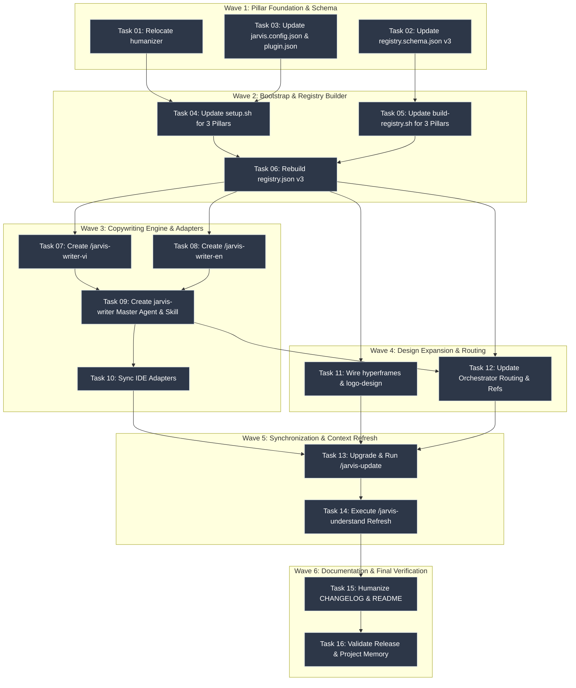

# Plan Overview — Jarvis-Matrix v0.3.0

> Companion to [PRP-v0.3.0.md](~/.gemini/config/plugins/jarvis-matrix/.jarvis/plans/v0.3.0/PRP-v0.3.0.md)  
> Spec Confidence: 99% | Compression Level: `ponytail-lite`

---

## 1. Plan Summary

Jarvis-Matrix v0.3.0 establishes a comprehensive **Three-Pillar Architecture** (`develop/`, `design/`, `copywriting/`):
1. **Copywriting Pillar (`copywriting/`)**: Relocates `humanizer` from `develop/` into `copywriting/` and registers `vietnamese-humanizer`. Introduces master agent `jarvis-writer` (`agents/jarvis-writer.md`) and `/jarvis-writer` (`skills/jarvis-writer/SKILL.md`) with intelligent language detection (deciding autonomously whether to route to Vietnamese or English), alongside dedicated bilingual writer skills `/jarvis-writer-vi` and `/jarvis-writer-en` with IDE adapter generation across Antigravity, Cursor, Claude Code, and Codex.
2. **Design Pillar Expansion**: Registers `hyperframes` (motion/captions/changelog) and `logo-design-skill` (branding & icon crafting) into `design/`, expanding `/jarvis-design` capabilities for both autonomous pipeline selection and direct sub-skill invocation.
3. **Core Tooling & Knowledge Refresh**: Updates `scripts/setup.sh`, `scripts/build-registry.sh`, `config/registry.schema.json`, and `/jarvis-update` to support all 13 external repositories. Runs `/jarvis-update` and `/jarvis-understand` to refresh the codebase knowledge graph, bumps version to `0.3.0`, and applies humanized writing to `CHANGELOG.md` and `README.md`.

---

## 2. Dependency DAG

---

## 3. Wave Execution Roadmap

| Wave | Tasks | Focus | Parallelism |
|------|-------|-------|-------------|
| **Wave 1** | Tasks 01, 02, 03 | Foundation: Move humanizer, update registry schema v3, update config v0.3.0 | Parallel |
| **Wave 2** | Tasks 04, 05, 06 | Core Scripts: Update setup.sh, build-registry.sh, generate registry.json v3 | Parallel (04, 05) ➔ Sequential (06) |
| **Wave 3** | Tasks 07, 08, 09, 10 | Copywriting Engine: Create /jarvis-writer-vi, /jarvis-writer-en, jarvis-writer master agent/skill, sync IDE adapters | Parallel (07, 08) ➔ Sequential (09, 10) |
| **Wave 4** | Tasks 11, 12 | Design Expansion & Routing: Wire hyperframes/logo-design, update rules & references | Parallel |
| **Wave 5** | Tasks 13, 14 | Synchronize & Refresh: Run /jarvis-update across 3 pillars, run /jarvis-understand | Sequential |
| **Wave 6** | Tasks 15, 16 | Docs & Memory: Humanize CHANGELOG/README, update PROJECT_MEMORY.md & release audit | Sequential |

---

## 4. Numbered Task Index

- [01-relocate-humanizer-to-copywriting.md](~/.gemini/config/plugins/jarvis-matrix/.jarvis/plans/v0.3.0/01-relocate-humanizer-to-copywriting.md)
- [02-update-registry-schema-v3.md](~/.gemini/config/plugins/jarvis-matrix/.jarvis/plans/v0.3.0/02-update-registry-schema-v3.md)
- [03-update-jarvis-config-v030.md](~/.gemini/config/plugins/jarvis-matrix/.jarvis/plans/v0.3.0/03-update-jarvis-config-v030.md)
- [04-update-setup-script-three-pillars.md](~/.gemini/config/plugins/jarvis-matrix/.jarvis/plans/v0.3.0/04-update-setup-script-three-pillars.md)
- [05-update-build-registry-three-pillars.md](~/.gemini/config/plugins/jarvis-matrix/.jarvis/plans/v0.3.0/05-update-build-registry-three-pillars.md)
- [06-rebuild-registry-v3.md](~/.gemini/config/plugins/jarvis-matrix/.jarvis/plans/v0.3.0/06-rebuild-registry-v3.md)
- [07-create-jarvis-writer-vi-skill.md](~/.gemini/config/plugins/jarvis-matrix/.jarvis/plans/v0.3.0/07-create-jarvis-writer-vi-skill.md)
- [08-create-jarvis-writer-en-skill.md](~/.gemini/config/plugins/jarvis-matrix/.jarvis/plans/v0.3.0/08-create-jarvis-writer-en-skill.md)
- [09-create-jarvis-writer-agent.md](~/.gemini/config/plugins/jarvis-matrix/.jarvis/plans/v0.3.0/09-create-jarvis-writer-agent.md)
- [10-sync-ide-adapters-for-copywriting.md](~/.gemini/config/plugins/jarvis-matrix/.jarvis/plans/v0.3.0/10-sync-ide-adapters-for-copywriting.md)
- [11-wire-hyperframes-and-logo-design.md](~/.gemini/config/plugins/jarvis-matrix/.jarvis/plans/v0.3.0/11-wire-hyperframes-and-logo-design.md)
- [12-update-routing-rules-copywriting.md](~/.gemini/config/plugins/jarvis-matrix/.jarvis/plans/v0.3.0/12-update-routing-rules-copywriting.md)
- [13-upgrade-and-run-jarvis-update.md](~/.gemini/config/plugins/jarvis-matrix/.jarvis/plans/v0.3.0/13-upgrade-and-run-jarvis-update.md)
- [14-run-jarvis-understand-refresh.md](~/.gemini/config/plugins/jarvis-matrix/.jarvis/plans/v0.3.0/14-run-jarvis-understand-refresh.md)
- [15-humanize-changelog-and-readme.md](~/.gemini/config/plugins/jarvis-matrix/.jarvis/plans/v0.3.0/15-humanize-changelog-and-readme.md)
- [16-validate-release-and-project-memory.md](~/.gemini/config/plugins/jarvis-matrix/.jarvis/plans/v0.3.0/16-validate-release-and-project-memory.md)

---

## 5. Compression Assignments

| Task ID | Ponytail Level | Caveman Mode | Rationale |
|---------|----------------|--------------|-----------|
| Task 01 | ponytail-lite | standard | Directory move & path verification |
| Task 02 | ponytail-lite | standard | Schema JSON edit |
| Task 03 | ponytail-lite | standard | Config JSON & plugin manifest version bump |
| Task 04 | ponytail-lite | standard | Bash script update for 3 pillar loops |
| Task 05 | ponytail-full | standard | Bash registry scanner logic across non-standard layouts |
| Task 06 | ponytail-lite | standard | Execution of registry build & output verification |
| Task 07 | ponytail-full | standard | Complex Vietnamese prompt engineering & memory integration |
| Task 08 | ponytail-full | standard | Complex English prompt engineering & memory integration |
| Task 09 | ponytail-full | standard | Language routing heuristics & master agent definition |
| Task 10 | ponytail-lite | standard | Script sync & adapter generation for 3 writer commands |
| Task 11 | ponytail-full | standard | Multi-agent markdown updates across 4 agent files |
| Task 12 | ponytail-full | standard | Multi-file reference update across rules and skills |
| Task 13 | ponytail-lite | standard | Sub-agent pull loop execution & memory update |
| Task 14 | ponytail-full | caveman | Heavy codebase analysis via UA + graphify |
| Task 15 | ponytail-full | standard | High-quality humanized technical writing |
| Task 16 | ponytail-lite | standard | Memory audit & release validation |
